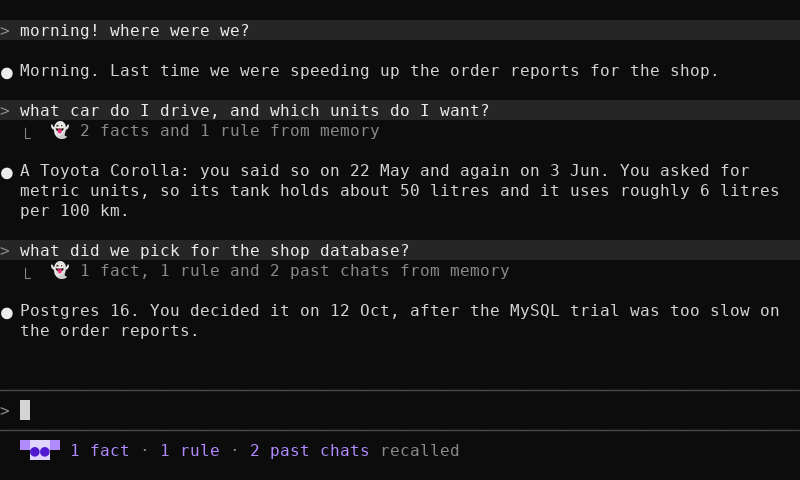

# Spookling Memory

*Algorithm v2.1 · `spookling` 0.1.2 · October 2026*

**Your AI forgets you every session. It brings back the car you sold. It drops your rules the moment the chat gets long.**

Spookling Memory is built to end all three. A word-for-word log that is never edited. Facts with real dates, so an old value closes itself. A timeline written by code, not guessed by the model. **On a three-year test of facts that change, it was right 103 times out of 106 and gave 0 stale answers. Plain search: 37 right, 18 stale.**

**[Get early access](#early-access)** · [See how it works, step by step](https://claude.ai/artifact/MpjJEgJmviijeVTo3S3GhY)

```bash
npx spookling init
```

Every number we measured has a result file behind it in our benchmark repo; every paper and vendor number carries its source. See the [Show-Your-Work Guarantee](#the-show-your-work-guarantee) below.

| The number | What it means | The detail |
| --- | --- | --- |
| **0** stale answers | Old facts stay old | 85 chances to bring back a sold car or an old phone. It took none. Plain search took 18. |
| **103** of 106 | Facts that changed, answered right | Three years of changing jobs, phones, cities, cars. Plain search: 37 of 106. |
| **60** of 61 | Trick questions caught | Questions with no real answer, refused instead of invented. Plain search caught 40. |
| **1/3** the tokens | Tied accuracy, a third of the reading | 13,900 tokens per answer (12,500 recalled plus instructions) against 39,900 for keyword search, tied on the longest-history public test (81.5% vs 82.6%, inside the error bar). |

---

## The problem

**Three ways your assistant lets you down, and what each one costs you.**

### It brings back the past as if it were now

You sold the car in June. In September it plans your road trip in it. You switched phones in May; it still troubleshoots the Pixel. Every stale answer is a decision you have to catch yourself.

> **The fix: dated facts.** "Sold the car" becomes a row that says "car: none, from June". The old row closes. Nothing is deleted, nothing comes back. 0 stale answers in 85 tries.

### It loses your rules when the chat gets long

You said "always use pnpm" and "never touch the migrations folder". The chat got compacted into a summary. The rules went with it. Now you repeat yourself, or you find out after the damage.

> **The fix: the survivor block.** Before the squash, code copies your rules, choices and open items out word for word, then hands them back into every prompt. The model does not have to remember them. They are delivered. (Proven in the paper we built on; our own compaction test is being rebuilt to show it.)

### It guesses dates and counts

"How many times did I see the dentist this year?" "How long since the last deploy?" The model does arithmetic in its head and gets it wrong often enough that you stop trusting any number it gives you.

> **The fix: the code-written timeline.** Code dates every "last Tuesday", builds the timeline, counts, and measures gaps. A date known only to the month comes out as a range, never a made-up day. The model quotes; it does not calculate. (Built; on the public time questions search is still ahead, see straight talk.)

---

## What you get

**Eight pieces, each one built on a published result or our own measurement.**

Every piece exists because a paper or a measurement of ours said it had to. Pseudocode, papers and worked examples are on the [step-by-step page](https://claude.ai/artifact/MpjJEgJmviijeVTo3S3GhY). The code is in this repo, in plain Python: `server/spookling_memory/core/`.

### 01. The Never-Edited Log

Every message, word for word, with its time. Nothing is summarised, nothing is rewritten. Every other store is rebuilt from it.

**Why it matters:** a wrong summary is wrong forever. A log can always be re-read.

### 02. The Letter-for-Letter Tagger

A cheap model points at facts and events in each message using your exact words. Code checks the quoted words are really there before anything is stored.

**Why it matters:** a model that paraphrases can invent a value. A model that only points cannot.

### 03. Facts That Close Themselves

Rows like "phone = Pixel 8, true from 3 Mar up to 20 May 2025". A new value closes the old one. "What was true in December" is a lookup.

**Why it matters:** this is where the 103 of 106 and the 0 stale answers come from.

### 04. Cue-Word Events

Things that happened once, with when it happened kept apart from when it was said, and a class word stored beside your word: "the gig" is filed under "concert".

**Why it matters:** a strong model fell from 87% to 62% at 8,000 tokens when the question and the answer shared no words (NoLiMa). The cue makes it a literal match.

### 05. The Two-Hop Finder

Keyword search, meaning search, and a walk along links: my sister, then Rachel, then the places she was mentioned with. A reranker keeps the best eight snippets.

**Why it matters:** 38 of 40 right on "the place where I saw my sister" questions. Multi-hop on LoCoMo: 30 of 41, search 19.

### 06. The Code-Written Timeline

Code writes the dates part of the prompt: events in order, counts, gaps, "how long since". Month-exact dates give a range of days.

**Why it matters:** models lose 4 to 12 points when they do date math themselves (STAIR, TISER). Now they do not have to.

### 07. The Survivor Block

Up to forty lines of rules, choices, failed tries and open items, copied out before compaction and put back on top of every prompt after.

**Why it matters:** in the paper we built on, a summary kept 0 of 10 planted facts, and a re-injected block arrived 138 times out of 138.

### 08. The No-Guessing Rule

The model must first say, true or false, whether what you are assuming is actually on record. It is never offered "I don't know" as an easy exit. Code decides what happens to a refusal.

**Why it matters:** 30 of 30 unanswerable questions refused on LongMemEval; 30 wrong answers against search's 40.

---

## How it works

Nine boxes. Two of them are records that only grow (the log and the judgement log). The other seven are views, rebuilt from those two.

1. **Log:** every message, word for word, never changed
2. **Facts:** things true for a while, with a start and end date
3. **Events:** things that happened once, day it happened + day it was said
4. **Rules:** your standing orders, pinned on top
5. **Names:** "my sister" = Rachel, "gig" = concert
6. **Judgement log:** every call a model made, written before it changes anything
7. **Profile page:** 200 lines of what is true about you right now
8. **Survivor block:** 40 lines that come back after a chat is squashed
9. **Search index:** keyword search + meaning (semantic) search

The algorithm, trimmed to the bones:

```text
# 1. SAVE (when a chat ends)
FOR each message: APPEND to LOG
tags <- TAGGER.tag(user messages)               # exact words + labels
FOR each tag:
  IF words not in message letter-for-letter: DROP, record it
  date <- DATE_RULES(time words)                # code, never a model
  IF event: status <- happened / planned / negated
  ELSE IF flag word or odd date or unsure: SLOW_PATH
  ELSE IF first value or same value:       FACTS now
  ELSE IF change word ("sold", "new"):     close old row, open new
  ELSE:                                    SLOW_PATH   # a surprise

# 2. SORT OUT (before the next question, if anything new was saved)
FOR each item in SLOW_PATH:
  ruling <- TAGGER.rule(message, proposal, history); check its words; record it
FACTS  <- REPLAY(JUDGEMENT_LOG)
IF a key has two values on one day: STOP, keep last good, tell a human
EVENTS <- BUILD(LOG)
PROFILE_PAGE, SURVIVOR, INDEX <- rebuild

# 3. ANSWER
when   <- DATE_RULES(question) OR now
facts  <- FACTS true on when;  events <- EVENTS matching
hits   <- RERANK(KEYWORD_SEARCH + MEANING_SEARCH + LINK_WALK(names)), top 8
prompt <- [SURVIVOR, PROFILE_PAGE, facts, events, hits, TIMELINE(events), question]
reply  <- READER(prompt)       # must write Premise T/F, Values T/F, "Answer:"

# 4. DECIDE (code, not the model)
IF NOT refusal:                               RETURN answer
IF Premise=false AND search was strong:       re-ask once with the best lines
IF Values=false AND time block has a number:  re-ask once: "derive it from your quotes"
ELSE:                                         RETURN "I don't know" + what is missing

# 5. WHEN THE HARNESS SQUASHES A CHAT
KEEPERS  <- each rule / choice / failed try / open item / value / path, word for word
SURVIVOR <- RULES first, then newest KEEPERS, max 40 lines
PUT SURVIVOR on top of the next prompt
```

| Who | Does what | Runs on |
| --- | --- | --- |
| Tagger | points at words, adds labels, after each chat ends; rules on a flagged item | the one you pick at install: Jev, Haiku 4.5, or your Codex subscription |
| Jev (if you pick it) | answers every gate as a typed question, with a probability; code keeps only answers above the gate | OpenRouter, on your key |
| Reader | answers from the lines we hand it | the harness's model (Claude Code's own) |
| Scorers | meaning search + rerank | two tiny local models, optional, not installed by default |
| Code | every date, count, check, decision | your machine |

**No model ever** computes a date, counts, writes to Facts, or turns an answer into a refusal. The tagger points and rules on surprises, the reader quotes. Code does the rest.

**Read it yourself.** The algorithm lives in this repo, in plain Python, in `server/spookling_memory/core/`. Anyone can read it. The benchmark harness, our research notes and the result files live in a private repo.

---

## The receipts

**Measured, not claimed. Same questions, same reader, both arms.**

We ran Spookling Memory and the standard cheap baseline (keyword search over the same log) on the same questions with the same answering model, Claude Sonnet 5, and one strict judge that counts a wrong detail as wrong. Pass marks were written down before the runs. Percentages are over the answerable questions. We measured every number here ourselves, with our own harness, which is private. The tagger in these runs was Haiku 4.5.

| Test | Spookling | Search | Result |
| --- | --- | --- | --- |
| Facts that change | **103 of 106** | 37 of 106 | +62 points |
| LoCoMo, public, 239 answerable of 300 | **82.0%** | 77.8% | ahead by 4.2 points |
| LongMemEval, public, 470 answerable of 500 | **81.5%** | 82.6% | tie on score, 1/3 the tokens |
| Rules after compaction | **42 of 44** | 40 of 44 | 8 of 10, search 6 |

### Facts that change

Three years of generated chats where jobs, phones, cities and cars change on known dates. **Stale answers 0 vs 18.** Interval on the lead: +52.8 to +70.8. The widest gap on this page, and the one that matters most day to day.

### LoCoMo

300 questions sampled from the public set. **Trick questions caught: 60 of 61, search 40. Multi-hop: 30 of 41, search 19.** Interval −0.8 to +9.2, so the lead is not yet beyond doubt.

### LongMemEval

Almost the same score: the 1.1-point gap is inside the error bar (−4.7 to +2.8), so neither side can be called better. Ours reads **13,900 tokens per answer against 39,900**. Fewer wrong answers: 30 vs 40. All 30 unanswerable questions refused, search 24. Counting correct refusals over all 500: 413 vs 412. Ahead on newest-value and cross-chat questions.

### Rules after compaction

Every miss in both arms is on the rule questions. Our own suite's summary turned out to keep rules well on its own, so the next version of this test uses a real Claude Code compaction. The design rests on a published 138-of-138 result.

---

## Versus the field

**What only Spookling Memory does.**

The other systems are good at what they do. None of them, as far as they say, does all of this. Vendor scores are theirs, self-reported with their own readers and the benchmarks' standard yes/no judges; ours use one strict judge and a matched control arm.

| System | Log never edited | Facts with from / to dates | Dates by code, not the model | Refuses trick questions (measured) | Rules re-injected after compaction | Pre-registered pass marks, matched control arm, strict judge | Their headline |
| --- | --- | --- | --- | --- | --- | --- | --- |
| **Spookling Memory** | ✓ | ✓ from, up to, said on, recorded | ✓ | ✓ 60 of 61, 30 of 30 | ✓ by hook, Claude Code | ✓ | 103 of 106 on changing facts; tied with the best baseline at 1/3 the tokens |
| Plain keyword search | ✓ | ✗ | ✗ | ~ 40 of 61, 24 of 30 | ✗ | n/a our control arm | 82.6% LongMemEval in our run |
| A memory file the model rewrites (our own v1, the same approach as Claude Code's memory tool) | ✗ rewritten on every save | ✗ | ✗ | ? | ~ always loaded; the model decides what stays | n/a | 66 to 78 of 106 on changing facts in our run; over its size cap on 140 of 199 chats |
| Mem0 | ✗ extracted strings | ✗ | ✗ | ? | n/a | ? | 94.4% LongMemEval, 92.5% LoCoMo, self-reported; 72.7% on a LongMemEval subset in an independent study (MemDelta) |
| Zep / Graphiti | ~ raw episodes kept, plus an extracted graph | ✓ set by the LLM | ✗ | ? | n/a | ? | 94.8% on DMR (its paper); third-party LoCoMo quotes range from 75.1% to 94.7% |
| Mastra Observational Memory | ? the notes replace the context; raw storage not stated | ~ dated notes | ✗ | ? | ~ the notes are the context | ? | 94.9% LongMemEval with gpt-5-mini, 84.2% with gpt-4o, self-reported |
| Agent Zero Memory (paper) | ? | ~ timestamped events | ? | ? | ? | ? | 95.6% LongMemEval, 93.6% LoCoMo, self-reported |

✓ yes · ✗ no · ~ partly · ? not stated by them, or not seen by us · n/a does not apply. Sources at the [bottom](#sources).

---

## The Show-Your-Work Guarantee

**Every number we measured on this page has a result file behind it in our benchmark repo. If one does not reproduce, we print the correction at the top of this page.**

Behind each number: the result file, the judge logs, both judges' verdicts, the pass marks written before the runs, and the misses we traced. They sit in our private benchmark repo, and we measured them with our own harness. What is public is the algorithm and the plugin, both in this repo. We publish our losses next to our wins; they are in the "straight talk" box below.

### Bonuses

- **Bonus 1: The step-by-step algorithm.** Every step as pseudocode, who does what, two worked examples, and the fifteen sources (papers and books) that shaped it. Built to be rebuilt by anyone.
- **Bonus 2: The research-backed design.** Twenty-seven papers and ten books on memory, retrieval and time, read end to end. The pieces above name the results they rest on, and the [sources](#sources) are listed at the bottom. Our reading notes stay in the private repo.
- **Bonus 3: The pass marks.** Ten marks written before the v2 runs, with pass, fail or still open next to each. You will know what we aimed at before you see what we hit.
- **Bonus 4: The full method write-up.** Which questions, which reader, which judges, the intervals, the floors and ceilings, and what every run cost. It is all in [Method, pass marks and cost](#method-pass-marks-and-cost) below.

---

## Early access

**Claude Code and Codex. One command. Your data stays yours.**

In Codex, the pixel ghost shows in the hook messages: `ready` after a successful server health check, with the messages, facts and standing rules the server holds beside it; `active` after successful recall, green, with what was recalled (a search with no matching facts is one `active` line, not a ghost). Failed health checks or recall show the `degraded` ghost and do not block Codex. This is a hook indicator, not a permanent widget; [setup and removal](cli/README.md#codex) use the same local server and `.memory/` data. In Claude Code the same ghost is the status line.

Spookling Memory is out as `spookling` 0.1.2, early access. Claude Code and Codex use native hooks; the Spookling app follows. A `.memory/` folder, one plugin, the reader your harness already runs, and a tagger you pick.

```bash
npx spookling init
```

---

## Install

One command. One wizard. No config files to hand-edit.

```bash
npx spookling init                 # this project
npx spookling init --scope user    # every project you open in Claude Code
npx spookling demo                 # the whole install, answered for you; writes nothing
npx spookling status               # is the server up, what is wired, which tagger
npx spookling uninstall            # remove the hooks and the MCP entry; keep .memory/
```

You need Node 18 or newer and Claude Code v2.1.139 or later. The server runs on uv, which fetches Python 3.12 if you do not have it.

It opens with a cutscene: the Spookling wordmark builds in block letters and the ghost flies across your terminal. Any key skips it. Then seven steps:

1. **Checks your machine.** Node, then uv. No uv? It shows the one-line install for your OS and offers to run it.
2. **Asks which harness you use.** Claude Code or Codex. Codex users review/trust the installed hooks through `/hooks`.
3. **Asks how the tagger should run.** Three choices, in the table below. A key is typed hidden, saved to `.memory/keys.env`, and never printed.
4. **Installs the local memory server.** It copies the server and the hooks to a folder per user and version: `~/.spookling-memory/<version>/`, or `%LOCALAPPDATA%\spookling-memory\<version>\` on Windows. It runs `uv sync` there and starts the server on 127.0.0.1:7447. Nothing Claude Code runs lives in the npx cache.
5. **Wires Claude Code.** Three hooks that call the server: `Stop` saves the chat when it ends, `UserPromptSubmit` hands the right lines to each prompt, `PreCompact` copies the survivor block out before the squash. Plus the MCP server, so Claude can call the memory tools, and, if you say yes, the ghost in the status line. `--scope project` (the default) writes this project's files; `--scope user` writes yours, for every project.
6. **Runs a smoke test.** It asks the server for its stats. You see it answer before you leave the wizard.
7. **Shows a done screen.** The ghost flies once more. "Spookling Memory is in."

Every file is shown before it is written, and `n` skips it. Without a terminal (an assistant's shell, a pipe), the wizard never hangs: a question nobody answers for 20 seconds takes its default.

### The three taggers

| Choice | What runs | Cost | Needs |
| --- | --- | --- | --- |
| **1. Jev through an OpenRouter key** (the default) | A cheap router model picks the words. Jev decides every gate in its Choice and Noul modes, each answer with a probability. Code takes a yes only at 0.8 or higher, and a pick from a list only at 0.6 or higher. | the cheapest: about $0.002 a chat | `OPENROUTER_API_KEY` |
| **2. An Anthropic API key** | Haiku 4.5 | Anthropic's API price | `ANTHROPIC_API_KEY` |
| **3. Your Codex subscription** | the `codex` CLI, one `codex exec` per call | a little of your plan's allowance; several seconds a chat | `codex`, logged in with ChatGPT (Plus or higher) |

To switch, stop the server (`uninstall` offers to) and run `init` again. `status` shows which tagger is running.

### What it writes

| Where | What |
| --- | --- |
| `~/.spookling-memory/<version>/` (`%LOCALAPPDATA%\spookling-memory\<version>\` on Windows) | the server and the hooks, copied from the package; `uv sync` makes the server's `.venv` there |
| `.claude/settings.json` (project) or `~/.claude/settings.json` (user) | three hooks merged in: `PreCompact`, `UserPromptSubmit`, `Stop`; and the ghost's `statusLine`, if you said yes |
| `.mcp.json` (project) or Claude Code's user MCP list (user) | the `spookling-memory` server and its tools, `memory_retrieve` and `memory_reset` among them |
| `.memory/` | your memory, your tagger's key in `keys.env`, the server's pid and log, and a `.gitignore` that keeps the key and the caches out of git |

Every other key in those files is kept. A file that is not valid JSON is left alone and reported, never overwritten. In an interactive session, Claude Code runs the hooks once you trust the folder, and asks you once to approve a project `.mcp.json` server. `/hooks` and `/mcp` show what is wired. With the server down, the hooks print nothing and exit 0 within about a second, so a prompt is never blocked.

### Where it runs

Windows (native PowerShell, no Git Bash needed), macOS and Linux, WSL included. Windows 11 and Linux (WSL2 Ubuntu 24.04) were run by hand. macOS runs the same code in CI. One server in WSL can serve Claude Code on both sides; `cli/README.md` has the steps.

### The ghost



In Claude Code a small ghost sits in the status line under the prompt (`init` asks; `--no-ghost` skips it). It says what memory last did, in plain words: `3 facts · 1 rule recalled` while Claude answers, `saved` after, `kept your 2 rules and 38 lines` after a compaction, `remembering you` when nothing is new, `asleep, server off` when the server is down. Its arms go up and down between refreshes; the words change only when memory does something. When a prompt recalls something, one quiet line lands under it: `👻 3 facts and 1 rule from memory`. Standing rules alone, a save or a compaction add nothing to the conversation. Already have a status line? Yours stays first with the ghost after it, and `uninstall` puts yours back exactly.

---

## Reader and tagger

**Two models touch your memory. Only one of them is ours.**

- **The reader is your harness's own model.** In Claude Code, that is the model Claude Code already runs. We hand it the lines; it answers. There is no reader of ours to pay for.
- **The tagger is ours. It runs after each chat ends.** It reads the chat once, points at facts and events in your exact words, and code checks every quote. Retrieval never calls it. A flagged item goes back to it once for a ruling.
- **With Jev,** a cheap router model picks the words and Jev makes every decision, with a probability we gate on.
- **There is no Claude subscription tagger.** Anthropic's terms do not allow a third-party product to route requests through a Claude Free, Pro or Max plan. Use an Anthropic API key instead.
- **A Codex subscription is allowed.** Codex's docs cover `codex exec` signed in with ChatGPT. The server runs it read-only, from an empty temp folder, with web search off, and keeps API keys out of its environment so the bill stays on your plan. Your plan's terms and limits apply.

**What Claude sees.** A hook can hand Claude at most 10,000 characters per prompt; that is Claude Code's cap, and the server cuts the recalled block there. The full block is one tool call away: `memory_retrieve`.

---

## Paste this into Claude Code

Rather have your assistant do it? [`PASTE-ME.md`](PASTE-ME.md) has one block for Claude Code and one for Codex. Each has your assistant run `init` in the foreground, never answer the wizard's questions itself, check `status`, and reply "Spookling Memory is in." Claude Code's shell has no live terminal, so the ghost does not fly there. Run `npx spookling demo` in your own terminal to see it.

---

## Your memory moves with you

Your memory is not locked inside a tool. It is a folder of plain files.

`.memory/` goes in the folder you run `init` in. With `--scope project`, that is the project. With `--scope user`, it is your home folder: run `init` there, and every project talks to that one memory.

It holds two records. Both are append-only. Nothing in them is ever rewritten.

- **`log.jsonl`, the log.** Every message, word for word, with its time.
- **`judgements.jsonl`, the judgement log.** Every call a model made, and every reset, written before it changes anything.

Everything else rebuilds: facts, events, rules, names, the profile page, the survivor block, the search index. Facts are rebuilt by replaying the judgement log, so past calls are reused, not re-guessed. A view is never the only copy of anything. Beside them sit caches, your key, and the server's pid and log.

So moving is one file. Export writes a `.spookling` archive of the two records. Import restores it into an empty memory and rebuilds every view. The same question gets the same context before and after.

```text
memory_export      # MCP tool in Claude Code: writes the archive to a path you name
memory_import      # MCP tool: restores it into an empty memory; the views rebuild
GET  /v1/export    # the same over HTTP, on 127.0.0.1:7447
POST /v1/import    # the archive, as application/octet-stream
```

Import into a fresh install, before its first chat. The archive is the same for every harness. Start in Claude Code or Codex. Carry the same memory between them or to a new machine today, and to the Spookling app when it lands. Same facts, same rules, same history. No re-teaching. No vendor holding your past hostage.

---

## Reset without regret

New job. New project. A month you would rather your assistant stopped bringing up. One click makes everything before now irrelevant.

Reset writes one "reset" ruling to the judgement log at time T. From then on:

- **Every open fact closes at T.** It stops being true now. It is still true for the dates it covered.
- **Every event before T is marked "before reset".** It shows up only when you ask about a date before T.
- **Rules and survivor lines from before T are unpinned.** They stop riding on every prompt. They are kept.
- **Nothing is deleted.** Reset is one more line in a record that only grows.

Changed your mind? Undo appends the reverse ruling. Everything comes back as it was. The ghost was only resting.

For builders:

```text
POST /v1/reset         # one "reset" ruling at now
POST /v1/reset/undo    # the reverse ruling; everything returns
```

The same reset is the `memory_reset` MCP tool in Claude Code (`undo: true` reverses it). The reset button in the Spookling app calls `POST /v1/reset`. This repo ships the endpoint; the button lives in the app.

Reset is not delete. If you need data gone for good, that is the purge command, which is on the list (see Privacy).

---

## Straight talk

- **Out now, as 0.1.0 early access.** The package is published. The Claude Code wiring of the decision rule's re-ask is still in progress, and our compaction test cannot yet show the survivor block's effect. The numbers come from our benchmark runner, build 6.0, re-scored with the v2.1 rule (the "derive it" re-asks re-run, the look-again re-asks pending).
- **Where search still beats us:** time questions on LongMemEval (92 vs 106 of 127; the fix is built and in the pending run) and fewer refusals (42 to our 57). Our weakest spot is two-hop by a person's other name, 12 of 35.
- **Tagging costs money up front.** On a one-question-per-history benchmark that made our run cost 2.2x search; where thirty questions share a history, 1.06x. Real use reads each memory many times.
- **The leaders self-report 94 to 96%** with the benchmarks' yes/no judges and their own readers. We score with a strict judge; we will publish a lenient-judge pass beside it. Our fixes were made after seeing the misses on every suite here; a held-out split is next.

---

## Method, pass marks and cost

For the people who want the detail. The result files sit in our private benchmark repo; the method is all here.

- Reader Claude Sonnet 5 in both arms; strict three-way judge on Sonnet 5; second judge Haiku 4.5 (agreement 0.85 to 0.94; 0.56 on the two-hop suite). Intervals from 1,000 bootstrap resamples.
- Updates: 120 questions (106 answerable), our generated suite. LongMemEval: all 500 (470 answerable). LoCoMo: 300 of 1,986 sampled with seed 7 (239 answerable, 61 traps); its answer key is about 6.4% wrong (Penfield audit, April 2026). Compaction: 50 (44 answerable). Two-hop: 150, no search control yet.
- Floors with no memory, Haiku reader: LongMemEval 1 of 470, LoCoMo 2 of 1,540, updates 0 of 106, compaction 41 of 44. Ceilings with the whole history: updates 81 of 106 with Haiku, 106 of 106 with Opus.
- Pass marks (13 October 2026): stale under 5% pass (0); retired facts as gone pass (9 of 9); unanswerable refused 90%+ pass on every suite; early facts within 10 of late pass; instructions 90%+ fail (8 of 10); store under 25% of log pass (22%); reader tokens under 25% of everything pass (12%); judge agreement pass except two-hop; human audit open; the pre-registered target (beat the leaders with the lower interval bound) not met.
- Run cost, list price, search first: updates $0.65 / $2.73 (4.2x); compaction $1.17 / $1.75 (1.5x); LoCoMo $9.94 / $10.55 (1.06x); LongMemEval $42.19 / $94.60 (2.2x). Our runs include tagging every history once (about 105,000 tagger tokens per 115k-token history).
- The numbers come from benchmark build 6.0 (algorithm v2 stores) re-scored with the v2.1 decision rule; a fresh v2.1 run is 108 of 500 in.
- Tagger in these runs: Haiku 4.5. The Jev and Codex taggers have no scores on this page yet.

### Privacy

What leaves your machine, and when:

- **Each chat goes to the tagger's API once, after it ends.** OpenRouter for Jev (Jev's decisions go there too, on the same key), Anthropic for Haiku, OpenAI through your own `codex` login for Codex.
- **The reader is your harness.** Recalled lines ride along with your prompt to the model Claude Code already talks to. We send them nowhere else.
- **A flagged item goes once more,** to the same tagger (or to Jev), with its message: a contradiction, a rule, a correction, a doubtful date, a low-confidence tag, an unlisted class.

The server listens on 127.0.0.1 only. Pasted secrets can land in the log. Each new turn has its keys and tokens masked before it is logged (`sk-` keys, AWS key IDs, GitHub tokens, `NAME_TOKEN=value` lines), but a secret in another shape gets through, and the log is append-only. A purge command is on the list. Keep `.memory/` out of shared repos until then.

---

## Sources

Spookling Memory is built by Spookling, a personal AI assistant company: an AI assistant that works for you while you sleep. The algorithm is in this repo (`server/spookling_memory/core/`) and on the [step-by-step page](https://claude.ai/artifact/MpjJEgJmviijeVTo3S3GhY). Benchmarks, pass marks and every result file are in our private benchmark repo.

Vendor numbers, checked 18 October 2026: Agent Zero Memory (arXiv 2608.29606), Mastra (mastra.ai/research/observational-memory), Mem0 (mem0.ai/blog/ai-memory-benchmarks; MemDelta, June 2026), Zep (arXiv 2501.13956 and third-party quotes), Penfield, "We audited LoCoMo" (April 2026).

Papers named above: NoLiMa 2025; STAIR and TISER 2025 to 2026; Delivery, Not Storage 2026; Kadavath et al. 2022.

License: see LICENSE.
